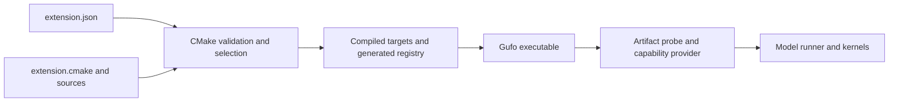

# Extensions

An extension adds a model to Gufo: its code, GPU kernels, tests and a
manifest, in one directory. This page shows how to add extensions to your Gufo
and what to check before you trust one.

## Official and community extensions

Every model in Gufo is an extension. The **official extensions** are the ones
listed in Gufo's release lock, `extensions.lock`: the maintainers review and
test them, and release packages, containers and the Windows ZIP include only
them. Every other extension is a **community extension**. It lives in its
author's repository and needs no change to Gufo.

An extension owns model-specific artifact loading, tokenization/framing, operators,
execution and capability adapters. Gufo provides the public interfaces, registry,
HTTP serving/scheduling and shared services exposed through those interfaces.
A text runner, for example, supplies model execution and state operations used by
the host's scheduler and continuation/cache policy.



One extension can contribute several providers, and those providers can share a
backbone. Each provider has its own capability, ID, artifact keys, supported
options and execution factory. Adding a model to an existing capability should
stay within its extension and package recipe. Introducing a new capability needs
a core interface proposal and review.

Include public headers through `<gufo/ext/...>` and link the public
`gufo_ext_runtime` target. Generated metadata constants are exposed under
`<gufo/ext/generated/...>`. The [SURFACE inventory](../../include/gufo/ext/SURFACE)
identifies the audited transitive source API. Private Gufo includes and links
are rejected for external extensions; keep your own implementation headers
inside your repository. The include checks enforce the source API boundary.
Extension code still has arbitrary native-code privileges during build and run.

Single-host text runners opt into component continuation with
`UsesComponentCache() == true`. They implement `cache::Adapter` and link
`gufo_ext_cache`, including its HIP backing in HIP builds.

Gufo-TP retains the native snapshot runner contract for mirrored TP2:
`CreateState`, snapshots/forks and persistence remain public, with default
component hooks for native runners. `TpMirroredRunner::UsesComponentCache()`
stays false, and state/snapshot operations execute on both ranks. In-pass
checkpoints remain disabled under TP2. The upstream 0.2 transition's removal
of native hooks does not apply to this retained TP contract.

### Link targets

`gufo_ext_runtime` declares the whole public surface but implements only its
neutral contracts. The `gufo` executable supplies everything else at its final
link, so a registration library needs nothing more. A test, probe or tool that
is its own executable must link the implementation of each service it uses:

| Target | Provides | Builds |
| --- | --- | --- |
| `gufo_ext_core` | GGUF reading and identity, sampling, JSON constraints, dequantization, SHA-256, image decoding, the hipBLASLt plan database, and `WeightUpload` in HIP builds. Also carries OpenSSL, which `sha256.hpp` exposes | all |
| `gufo_ext_cache` | Component cache; in HIP builds also `transfer_pool`, `host_allocations` and `component_cache_resources` | all |
| `gufo_ext_hip` | `ENGINE_ENABLE_HIP`, which the public HIP headers need, `hip::host` and the hipCUB and rocPRIM include paths | HIP only; list it under a target that requires `hip` |

These targets add no Gufo include path, so the source API stays the audited
surface. Linking `gufo_core` or `gufo_cache` directly is still rejected.

## Provide continuation

For component runners, the cache owns every execution slot and decides what to retain, evict and write
to disk. A runner describes its state and moves bytes on request:

- `CreateComponentCacheResources` returns the adapter and its backing. Build the
  backing with `hip::CreateHipComponentCacheResources`, and charge memory to the
  ledger it receives.
- `BindComponentState` wraps one slot in the runner's `TextRunnerState`.
- `ReconcileComponentState` runs after the cache restores rows into a slot, and
  brings the runner's own bookkeeping to that position.
- `cache::Adapter` declares each component as append rows, window rows or whole private state
  and copies it in and out. [adapter.hpp](../../src/cache/adapter.hpp) states the
  ordering and failure rules. Report positions per component, never from prompt
  length.

`gufo/ext/transfer_pool.hpp` and `gufo/ext/snapshot_copy.hpp` are the supported
helpers for those copies. Set `prefix_reuse` to false only for a runner which must
start each request cold. The cache identity must change whenever retained bytes
stop being valid: include the model artifact, context size and every setting that
alters state. An adapter test should restore each component and compare the
result byte for byte with an uninterrupted run.

## Start with the template

Copy [examples/extension_template](../../examples/extension_template/README.md) into
an independent repository. It contains:

| File | Purpose |
| --- | --- |
| `extension.json` | Identity, compatibility floor, providers, artifact keys, target requirements and inventory |
| `extension.cmake` | Targets, sources, public dependencies, tests and installation rules |
| `src/template_model.cpp` | Registration scaffold using generated metadata |
| `flake.nix`, `flake.lock` | Pinned Gufo package with this source added |
| `LICENSE`, `README.md` | Source license, ownership, build and support information |

Rename `template_model`, its target and registration symbols, the provider ID and
artifact key consistently. The template only registers metadata. Implement a
capability runner and independent tests before advertising working inference.

In the manifest, distinguish:

- `name` and `version`: this extension's identity and author-managed version.
- `api_version`: the minimum Gufo extension API needed by the interfaces you use.
- `registration_target` and `entry`: the target and function that register the
  extension's host-side behavior.
- `providers`: each capability implementation's ID, keys, model IDs, factory
  target and registration entry.
- `targets.requires`: conditions such as `hip` or `testing`; test targets use
  `role: "test"`. Disabled targets must not advertise usable device execution.
- `depends`: explicit extension/library dependencies. External consumers can use
  dependencies that satisfy the public API boundary; private family libraries
  do not become public just because an in-tree model links them.
- `options`, `packages`, `licenses`, `install_data` and `runtime_libraries`:
  option declarations and the dependency/distribution inventory. Keep them in
  agreement with the build and install recipe.

Separate host parsing/probes from HIP execution so diagnostics and probes can
work without creating a GPU context. Keep test-only code under the `testing`
condition; production packages disable it. Declare supported platforms honestly.

## A real example: `lfm3-gufo-extension`

The [LFM3 source repository](https://github.com/gufo-org/lfm3-gufo-extension)
shows a complete external implementation. The examples here refer to revision
`fb488aebef5abc3fefcbb21ce0d53eebe8cc3e27`:

| Part | What to read |
| --- | --- |
| Manifest and target layout | [`extension.json`](https://github.com/gufo-org/lfm3-gufo-extension/blob/fb488aebef5abc3fefcbb21ce0d53eebe8cc3e27/extension.json), [`extension.cmake`](https://github.com/gufo-org/lfm3-gufo-extension/blob/fb488aebef5abc3fefcbb21ce0d53eebe8cc3e27/extension.cmake) |
| Host registration and artifact resolution | [`extension.cpp`](https://github.com/gufo-org/lfm3-gufo-extension/blob/fb488aebef5abc3fefcbb21ce0d53eebe8cc3e27/extension.cpp), [`probe.cpp`](https://github.com/gufo-org/lfm3-gufo-extension/blob/fb488aebef5abc3fefcbb21ce0d53eebe8cc3e27/probe.cpp) |
| Typed text provider and runner factory | [`provider.cpp`](https://github.com/gufo-org/lfm3-gufo-extension/blob/fb488aebef5abc3fefcbb21ce0d53eebe8cc3e27/provider.cpp), [`runner.cpp`](https://github.com/gufo-org/lfm3-gufo-extension/blob/fb488aebef5abc3fefcbb21ce0d53eebe8cc3e27/runner.cpp) |
| CPU references, operators and sessions | [`reference.cpp`](https://github.com/gufo-org/lfm3-gufo-extension/blob/fb488aebef5abc3fefcbb21ce0d53eebe8cc3e27/reference.cpp), [`tests`](https://github.com/gufo-org/lfm3-gufo-extension/tree/fb488aebef5abc3fefcbb21ce0d53eebe8cc3e27/tests) |
| Published limitations and quality evidence | [`docs/QUALITY.md`](https://github.com/gufo-org/lfm3-gufo-extension/blob/fb488aebef5abc3fefcbb21ce0d53eebe8cc3e27/docs/QUALITY.md) |

Its `lfm3` extension contributes text, ASR, TTS and decision providers. The
backbone, audio, vision, text and decision targets share code while retaining
separate requirements and registration functions. Its manifest declares Linux
support. Those architectural examples do not establish Windows support or a
blanket quality verdict: its documentation records remaining API/quality failures.

The text provider registers generated metadata, then a typed execution provider:

```cpp
registry.AddProvider(gufo::ext::generated::extension_lfm3::kProvider_lfm3);
registry.AddTextProvider({
    .id = "lfm3",
    .probe = &gufo::models::lfm3::ProbeLfm3,
    .probe_gguf = &gufo::models::lfm3::ProbeLfm3Gguf,
    .create = &gufo::models::lfm3::CreateLfm3TextRunner,
    .bench_driver = &gufo::models::lfm3::RunLfm3Bench,
    .prompt_driver = &gufo::models::lfm3::RunLfm3Prompt,
    .chat_driver = &gufo::models::lfm3::RunLfm3Chat,
});
```

This excerpt belongs inside its provider registration function. Metadata makes
the provider discoverable; the typed callbacks supply actual execution. The
factory implements the public runner contract and reports errors through that
contract. CPU-only registration retains probe/resolve support with unavailable
execution factories where appropriate.

## Implement the model contract

Choose the capability interface first:

| Capability | Public header |
| --- | --- |
| Text generation | [`text.hpp`](../../include/gufo/ext/text.hpp) |
| Embeddings | [`embeddings.hpp`](../../include/gufo/ext/embeddings.hpp) |
| Speech recognition | [`asr.hpp`](../../include/gufo/ext/asr.hpp) |
| Speech synthesis | [`tts.hpp`](../../include/gufo/ext/tts.hpp) |
| Images | [`image.hpp`](../../include/gufo/ext/image.hpp) |
| Video | [`video.hpp`](../../include/gufo/ext/video.hpp) |
| Decisions | [`decision.hpp`](../../include/gufo/ext/decision.hpp) |

Read the interface and the relevant existing provider before writing the
adapter. Implement a cheap, deterministic artifact probe, validate model
metadata/shapes, and resolve required sidecars explicitly. A declared key such
as `gguf:lfm3` helps dispatch; the probe must verify the actual artifact. It must
not need GPU initialization or load the entire model onto a device. Ambiguous
matches must remain errors; do not steal another provider's artifacts with an
overly broad probe.

For a text model, own tokenization, chat/control framing and tool syntax in the
extension. Declare supported inputs, state/resource capabilities and sampling
defaults accurately. Implement incremental execution, cancellation, state
isolation and batching only under the contracts you advertise. To capture prefill
checkpoints without ending a pass at them, declare `in_pass_checkpoint` and
`max_in_pass_checkpoints`, and implement `PrefillCheckpointBytes` and
`PrefillThrough`; each capture must equal the state a pass ending at its boundary
leaves.
Preserve sampler/constraint state and cache compatibility identities
across rollback and continuation. Draft models/heads and sidecars stay with the
target model's artifact set. Wire the CLI prompt/chat/benchmark drivers as well
as the HTTP runner when those commands are supported.

A text provider supplies its recommended sampling through
`TextRunnerDescriptor::sampling_defaults` (HTTP) and
`TextProvider::sampling_defaults` (`prompt`/`chat`), both a
`sampling::TextSamplingDefaults` holding one set of optional values for thinking
enabled, disabled and unspecified. A provider with `prompt` or `chat` drivers
must set both, from one function: core cannot detect a provider that sets only
one, and its HTTP and command-line defaults would differ. Set values, including
zero, apply as written; unset controls stay neutral; the seed and output
constraint are never defaults. Invalid values fail model load or the command
before generation. Precedence is provider defaults, explicit server/CLI settings,
then per-request overrides, identically for HTTP, `prompt` and `chat`.
`sampling_preset` remains for existing extensions; in-tree models no longer use
it.

A text runner declares the literal framing of its reasoning with
`TextModelRunner::ReasoningDelimiters()`. The default follows
`ReasoningBudgetTags()`; override it when the model's text differs from those
control tokens, such as an opener spanning several tokens. Both describe the same
block: `ReasoningBudgetTags().start` is the one control token that begins `open`,
and `ends` include the control token for `close`. `close` must be non-empty and
`open` must not begin with whitespace; model load rejects either. With
`InitialOutputState::kThought` the prompt opened reasoning; with `kAuto` the
output opens it, and the parsers, usage accounting and reasoning budget all
start at a leading `open`. The budget counts from `start`, so the rest of `open`
counts toward it. Line breaks after `close` are framing and dropped, and Qwen's
tool dialect also drops other whitespace there.

### Native tool calls

A text model whose call syntax is not a built-in format registers a
`ToolDialect` from its extension registration and returns its `id` from
`TextModelRunner::ToolDialectId()`; no core enum entry or host branch is
needed. That one identity selects both the constrained grammar and the
buffered and streamed parsers of the Chat Completions, Responses and Messages
endpoints, and only its markers start calls. The registration supplies:

- `syntax`, a `JsonConstraint::ToolSyntax`: the call literals (`open`,
  `name_prefix`, `name_suffix`, `close`) and either `tagged` key/value
  parameters (the form of the built-in Qwen and DeepSeek grammars, which
  `JsonConstraint::Syntax()` returns for copying) or JSON-shaped arguments
  spelled by `values` (string delimiters, bare keys, whitespace, member order).
  Core compiles each tool's JSON schema into it for `required` and `auto` tool
  choice, strict and best-effort tools.
- `markers`, `reasoning_markers` and `closers` for the host's text handling,
  and `scan_tool_calls`, which reads calls back, including the unfinished call
  of a streamed partial parse. Values that are not JSON are converted to JSON
  text, which the host checks against the declared schema.

The constrained reasoning phase before an answer or call uses the runner's
`ReasoningDelimiters()`, as the response parsers do: it ends at `close` or at a
complete call header, and for `InitialOutputState::kAuto` the model may open it
with the complete `open` literal.

The contract, ownership and error rules are documented on `ToolDialect` in
[`text.hpp`](../../include/gufo/ext/text.hpp). Existing runners need no change:
the default `ToolDialectId()` is the built-in identity (`json`, `qwen`,
`deepseek`) of `ToolFormat()`.

Provider options use canonical names and manifest types. Extensions may declare
the same option when the type agrees, as providers sharing `--mtp-model` do; CMake
rejects conflicting types. The Nix serving helper derives provider arguments and validation
from metadata, including optional `serving` declarations. New runtime controls
also need actual command parsing/execution support; metadata alone cannot
implement them. See [Nix serving](nix-serving.md).

## Build and exercise the extension

From a Gufo checkout with its documented dependencies or pinned development
shell, add an absolute external source directory:

```sh
gufo diagnose --section extensions
gufo extension list
```

> **Warning:** An extension is native code that runs with your permissions,
> and its build scripts run when it builds. Add only extensions whose source
> you've read or whose author you trust, and pin each one to an exact revision.

There are two ways to add one: install it as a module into the Gufo you
already have, or compile it into your own Gufo build.

## Modules

`gufo extension` builds an extension as a loadable **module** for your
installed Gufo. Every later `gufo` command loads it.

```sh
gufo extension install lfm3                    # newest reviewed release
gufo extension install lfm3@0.4.0              # a specific reviewed release
gufo extension install ./lfm3-gufo-extension   # a local directory
gufo extension install https://github.com/gufo-org/lfm3-gufo-extension@967f5e13ad501e4a505988f20694fed1e442ead1
gufo extension update                          # after upgrading Gufo
gufo extension remove lfm3
```

As of November 2026, modules are experimental: the commands and the store
layout may still change.

**Reviewed releases.** A name, with or without `@version`, comes from the
[extension registry](https://github.com/gufo-org/gufo-extension), which lists
releases whose exact source a Gufo maintainer reviewed. Gufo refuses the
download unless it matches the reviewed digest. `GUFO_EXTENSION_REGISTRY`
points to another registry, as a URL or a file. Review protects against
malicious or careless code; it isn't a sandbox.

**Other sources.** No maintainer has looked at a directory or Git URL, so
`install` warns and asks for confirmation; pass `--yes` when there's no
terminal. A Git URL must name a commit or tag.

**Upgrades.** A module works only with the exact Gufo build it was compiled
for: the same compiler, ROCm, flags and API. After you upgrade Gufo,
`gufo extension list` shows `needs update`, and Gufo skips the module until
`gufo extension update` rebuilds it from its pinned source. `update` also moves
registry extensions to their newest reviewed release that your Gufo supports.

**Conflicts.** `install` refuses an extension whose name, provider, files or
model ID clash with one Gufo already has. `--replace-builtin` replaces the
built-in extension of the same name, for example to test a newer version.

### What a module build needs

`install` and `update` check these first and report everything missing at
once:

- CMake 3.27 or newer, and Ninja;
- the same C, C++ and HIP compilers that built your Gufo;
- the ROCm libraries and other dependencies of that build;
- Git, for Git sources and registry releases.

| Gufo from | Toolchain |
| --- | --- |
| The `gufo-runtime` container | Included; mount a volume at `/home/gufo/.local/share/gufo/extensions` to keep the store, as in [install](../install.md#container). |
| Nix | `nix profile install github:gufo-org/gufo#sdk` (or `#release-sdk`) installs Gufo with its build toolchain. |
| A source build | The build tree's `sdk`, or `<prefix>/lib/gufo/sdk` after installing, with the same system toolchain. |

`GUFO_SDK_DIR` points Gufo at an SDK elsewhere.

### Where modules live

Modules are stored in `$GUFO_EXTENSIONS_DIR`, or by default
`~/.local/share/gufo/extensions`. Removing an extension deletes its files;
processes already running keep using it until they exit.

### Pinning modules with Nix

A flake can build a Gufo with a fixed set of modules:

```nix
{
  inputs.gufo.url = "github:gufo-org/gufo/<revision>";
  inputs.lfm3 = {
    url = "github:gufo-org/lfm3-gufo-extension/<revision>";
    flake = false;
  };
  outputs = { gufo, lfm3, ... }: {
    packages.x86_64-linux.default = gufo.lib.x86_64-linux.withExtensionModules {
      extensions = [ lfm3 ];
    };
  };
}
```

## Compiling an extension in

When you build Gufo yourself, it compiles every extension in its tree plus the
directories you add:

```sh
cmake --preset release -DGUFO_EXTENSION_DIRS=/absolute/path/to/lfm3-gufo-extension
cmake --build --preset release --parallel 4
```

With Nix, override the package:

```nix
packages.x86_64-linux.default = gufo.packages.x86_64-linux.default.override {
  extensions = [ lfm3 ];
};
```

The build rejects a community extension that claims a file type, option or
model ID that an official extension owns, before compiling anything.

## Platforms

Linux on Strix Halo is the production platform. On Windows, modules are DLLs
that load only into `gufo.exe`. Each extension's manifest says which platforms
it supports.

To write your own, see [writing an extension](../writing-extensions.md).
